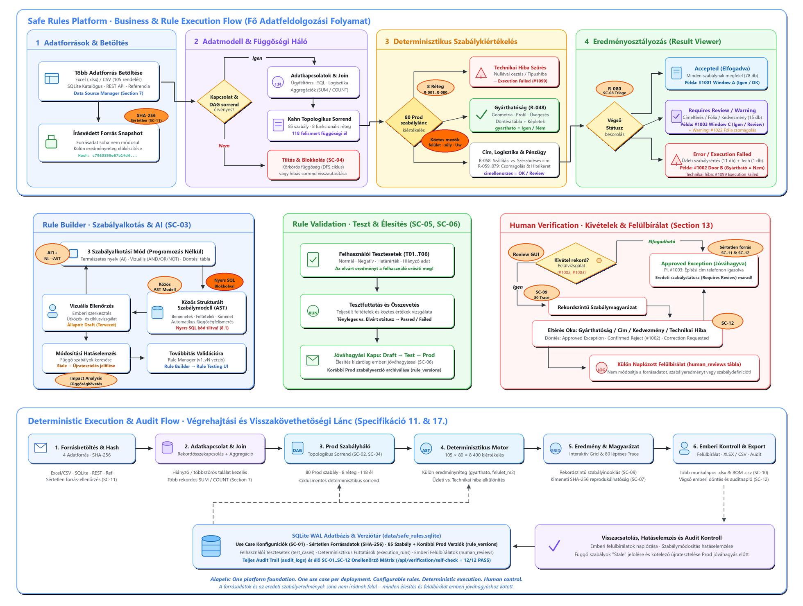

# SAFE RULES v1.2 – Rule-Based Data Validation & Enrichment Platform

> **Making complex business rules visible, manageable and reliable.**  
> *One platform foundation. One use case per deployment. Configurable rules. Deterministic execution. Human control.*

Ez a projekt a **SAFE RULES – Teljes rendszerkoncepció és funkcionális rendszerleírás (Verzió: 1.2)** specifikáció teljes körű, determinisztikus, önellenőrző megvalósítása.



---

## 1. Indítás és Tesztelés

### Előfeltétel
- **Node.js v22.5+ / v24+** (beépített `node:sqlite`, `node:test`, `node:crypto`, `node:zlib` modulokkal – külső csomagfüggőség és telepítési sérülékenység nélkül).

### Alkalmazás indítása
```bash
node server.js
```
A szerver alapértelmezetten a **`http://127.0.0.1:3080`** címen indul el.

### Automatizált tesztkészlet futtatása (SC-01 .. SC-12 ellenőrzés)
```bash
node --test tests/safeRules.test.js
```

### Adatbázis alaphelyzetbe állítása (Seed)
```bash
node src/db/seed.js --reset
```

---

## 2. Funkcionális Architektúra és Modulok (Specifikáció 6–15. fejezet)

A rendszer a specifikációban előírt teljes adatfeldolgozási láncot valósítja meg:

`Data Sources → Data Integration & Mapping → Rule Definition & Management → Rule Validation → Deterministic Execution → Result Viewer → Human Verification → Export & Audit`

| Modul | Fájl / Komponens | Megvalósított funkciók |
|---|---|---|
| **Adatbázis és Audit réteg** | [`src/db/database.js`](src/db/database.js) | SQLite WAL adatbázis: `use_cases`, `data_sources` (SHA-256 sértetlenséggel), `rules`, `rule_versions` (korábbi éles verziók megőrzése), `test_cases`, `execution_runs`, `record_results`, `human_reviews`, `audit_logs`. |
| **Strukturált Szabálymodell** | [`src/engine/ruleModel.js`](src/engine/ruleModel.js) | Közös strukturált AST modell: Vizuális feltételfák (`AND`/`OR`/`NOT`), Döntési táblák (`Decision Tables`: `FIRST`, `UNIQUE`, `COLLECT`) és biztonságos számítási kifejezések (`IF`, `ROUND`, `MIN`, `MAX`, `ABS`, `CONCAT`). Nyers SQL-injekció tiltása (8.1). |
| **Függőségi Háló és Sorrend** | [`src/engine/dependencyGraph.js`](src/engine/dependencyGraph.js) | Automatikus bemenet/kimenet függőségfelismerés, Kahn-féle topologikus rendezés, DFS körkörös függőség (ciklus) felismerés és tiltás, kézi sorrend-felülbírálat validálás, valamint tranzitív módosítási hatáselemzés (`Impact Analysis`). |
| **Determinisztikus Végrehajtó Motor** | [`src/engine/executionEngine.js`](src/engine/executionEngine.js) | 10 lépéses determinisztikus végrehajtás, több adatforrás összekapcsolása (`1:1`, `1:N`, hiányzó/többszörös találatok kezelése, több rekordot érintő aggregációk), üzleti hibák (`Error`, `Requires Review`, `Warning`) és technikai végrehajtási hibák (`Execution Failed`) szigorú elkülönítése. |
| **AI Szabály- és Tesztasszisztens** | [`src/engine/aiAssistant.js`](src/engine/aiAssistant.js) | Természetes nyelvű (magyar/angol) üzleti leírásból strukturált szabályjavaslat (`Draft` státuszban), ellentmondás- és átfedésvizsgálat, valamint 6 kategóriájú teszteset-javaslat (normál, negatív, határérték, hiányzó adat, ellentmondásos, láncolt). |
| **Natív Excel (.xlsx) és CSV Kodek** | [`src/engine/xlsxCodec.js`](src/engine/xlsxCodec.js) | Valódi több-munkalapos Office Open XML (`.xlsx`) generátor és olvasó, valamint magyar Excel-kompatibilis UTF-8 BOM (`.csv`) import/export. |
| **REST API és SC Önellenőrző** | [`src/api/router.js`](src/api/router.js) | Teljes REST API a 8 felhasználói felületi modulhoz + `/api/verification/self-check` végpont az SC-01..SC-12 valós idejű igazolásához. |
| **Felhasználói Felület (8+1 nézet)** | [`public/index.html`](public/index.html), [`public/app.js`](public/app.js) | Interaktív Result Viewer, Data Setup, Rule Manager, Rule Builder (AI + Vizuális + Döntési tábla), Rule Dependencies (DAG + Impact), Rule Testing & Approval, Execution, Human Verification és Audit/SC mátrix. |

---

## 3. Sikerkritériumok Teljesülése (Specifikáció 20. fejezet: SC-01 .. SC-12)

- **SC-01 (Új use case kódolás nélkül)**: Beépített *Nyílászáró-rendelésellenőrzés* (`UC-WINDOW-ORDERS`) és *Nemzetközi Szállítmány- és Vámellenőrzés* (`UC-SHIPMENT-VALIDATION`), valamint UI/API lehetőség új use case létrehozására alkalmazáskód-módosítás nélkül.
- **SC-02 (80+ egymástól függő szabály)**: 85 üzleti szabály (`R-001`..`R-085`, ebből 80 `Prod`, 2 `Test`, 2 `Draft`, 1 `Retired`) 8 funkcionális rétegbe szervezve, több mint 60 egymásra épülő adatfüggőségi éllel.
- **SC-03 (Programozási ismeret nélküli szabályalkotás)**: Vizuális feltételszerkesztő, Döntési tábla és Természetes nyelvű AI asszisztens.
- **SC-04 (Függőségek felismerése, érvénytelen sorrend tiltása)**: Körkörös függőség és kötelező függőséget sértő sorrend automatikus blokkolása.
- **SC-05 (Felhasználói tesztesetek és elvárt eredmények)**: `T01`..`T06` tesztesetek rögzítése, AI tesztjavaslatok felhasználói megerősítéssel.
- **SC-06 (Élesítés csak jóváhagyással)**: `Prod` státuszba kizárólag sikeresen tesztelt (`Passed`) szabály léptethető explicit emberi jóváhagyással.
- **SC-07 (Reprodukálhatóság)**: Azonos bemenet és szabálykonfiguráció bitről bitre azonos SHA-256 kimeneti lenyomatot eredményez.
- **SC-08 (Hibás/eltérő rekordok azonosítása)**: Specifikáció 5. fejezet szerinti referencia rekordok (`1001 Window A -> Accepted`, `1002 Door B -> Error`, `1003 Window C -> Requires Review`) és 105 tételes adathalmaz.
- **SC-09 (Szabályeredmények és indokok megtekintése)**: Rekordszintű szabálymagyarázat minden egyes rekordhoz a lefutott 80 szabály bemeneti, köztes és kimeneti értékeivel.
- **SC-10 (Excel/CSV-export)**: Több munkalapos `.xlsx` és UTF-8 BOM `.csv` letöltés.
- **SC-11 (Forrásadatok változatlansága)**: SHA-256 kontrollszumma bizonyítja, hogy sem a szabályfuttatás, sem az emberi felülbírálat nem módosítja a forrásadatot.
- **SC-12 (Visszakövethetőség)**: Teljes auditnapló, megőrzött `Prod` szabályverziók és külön rétegben tárolt emberi felülbírálatok.
